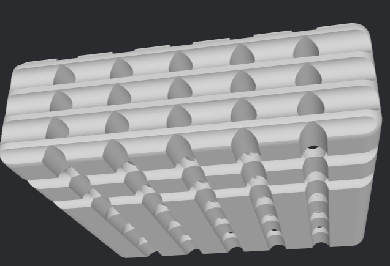

# 🧪 CQ-3D-Lab : Modélisation Paramétrique & Fabrication Additive en Python

Bienvenue dans mon laboratoire de recherche et de développement dédié à la **CAO paramétrique par le code** et à la **fabrication additive** (impression 3D). 

Ce dépôt rassemble mes scripts Python développés avec **CadQuery** pour générer automatiquement des géométries complexes, des structures poreuses (type *scaffolds* médicaux) et préparer des maillages `.stl` prêts à être imprimés.

---

## 🎯 Objectifs du projet
* **Automatisation géométrique :** Remplacer la modélisation manuelle par des algorithmes paramétriques reproductibles.
* **Ingénierie biomédicale & MedTech :** Concevoir des structures poreuses interconnectées favorisant la circulation des fluides et la colonisation cellulaire.
* **Chaîne numérique complète :** Maîtriser le flux de travail du script Python jusqu'à l'exportation et la validation du maillage `.stl` (slicing).

---

## 🛠️ Technologies utilisées
* **Langage :** Python 3
* **Moteur CAO :** [CadQuery](https://github.com) (basé sur OpenCascade)
* **Environnement :** CQ-editor
* **Validation & Slicing :** PrusaSlicer / Visualiseur STL

---

## 📂 Structure du dépôt

```text
cq-3d-lab/
├── 01-bases-geometrie/ # Scripts de modélisation paramétrique
│ ├── ma_premiere_piece.py # Bloc simple avec perçage central
│ ├── implant_poreux.py # Grille de pores 2D générée par boucles
│ └── implant_3d_interconnecte.py # Structure poreuse 3D (axes X, Y, Z) avec congés
├── exports-stl/ # Fichiers de maillages générés prêts pour l'impression 3D
├── images/ # Captures d'écran des rendus 3D
└── README.md
```

---

## 🚀 Réalisations & Aperçus 3D

### 1. Structure poreuse interconnectée 3D (`implant_3d_interconnecte.py`)
Génération algorithmique d'un échafaudage (*scaffold*) cubique doté de canaux traversants sur les trois axes de l'espace (X, Y et Z) et d'arêtes extérieures adoucies.

* **Concepts clés :** Paramétrisation dimensionnelle, calcul de grilles de coordonnées par boucles imbriquées, sélection de faces multiples (`>Z`, `>Y`, `>X`), application de congés (`.fillet()`).



---

### 2. Grille poreuse paramétrique (`implant_poreux.py`)
Création d'une matrice de perforations calibrées sur une plaque de base. L'espacement et le diamètre des pores s'ajustent dynamiquement via les variables en tête de script.

* **Concepts clés :** Listes de coordonnées, `.pushPoints()`, exportation automatisée au format `.stl`.


---

## 📈 Prochaines étapes (Feuille de route)
* [ ] **Variation de densité :** Faire évoluer le diamètre des pores selon leur position géométrique (gradient de porosité).
* [ ] **Imagerie médicale (DICOM) :** Extraction et segmentation d'anatomies réelles via **3D Slicer** et **Python (`pydicom`)** pour générer des guides ou implants sur mesure.
* [ ] **Génération directe de G-code :** Pilotage bas niveau des trajectoires d'extrusion.
